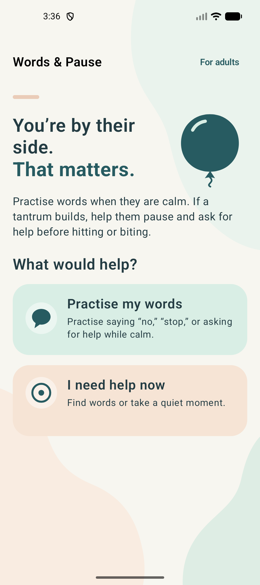
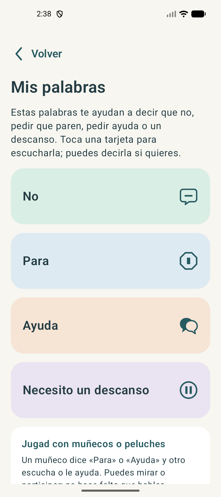
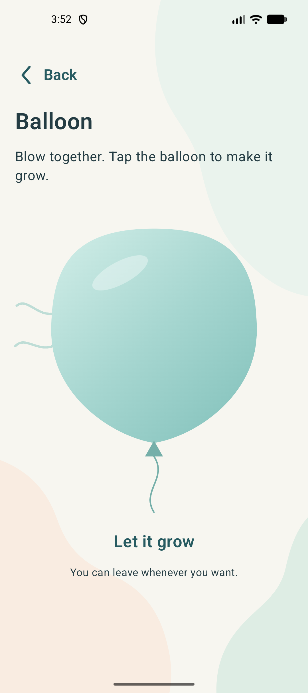

# Words & Pause · Palabras y pausa

A calm Android app for young children and an adult alongside them. Children can practise saying what they need while calm, or quickly choose words or a balloon activity when a tantrum is building. The adult guide explains why tantrums happen and offers practical ways to help keep everyone safe.

The app supports **English and Spanish** throughout, including spoken phrases. It follows the device language when supported, falls back to English otherwise, and lets adults choose a language in the app.

<p align="center">
  
  
  
</p>

## What it does

- **Practise my words:** Four large cards say “No,” “Stop,” “Help,” and “I need a break” aloud. The child can listen, speak along, or role-play with toys; the app never listens or evaluates speech.
- **I need help now:** One choice opens the same phrase cards; the other opens a touch-controlled balloon that grows and rests at the child's own pace. There are no scores, timers, or required steps.
- **For adults:** Short guidance for before, during, and after a tantrum, with links to its sources and a language selector.

The app supports expression and co-regulation. It does not promise to prevent tantrums or replace an adult's support.

## Technology and structure

This is a single-module Kotlin app using Jetpack Compose and Material 3. It has no backend or third-party analytics SDK.

| Area | Main files |
| --- | --- |
| Activity and navigation | `MainActivity.kt`, `AppFlow.kt`, `TogetherWordsApp.kt` |
| Child screens | `HomeContent.kt`, `HelpContent.kt`, `WordsContent.kt`, `BalloonActivity.kt` |
| Adult guide | `AdultGuide.kt` |
| Language and speech | `Language.kt`, `LanguageSettings.kt`, `PhraseSpeaker.kt`, `res/values*/strings.xml` |
| Visual style | `AppColors.kt`, `UiComponents.kt`, `res/drawable/` |

Navigation is a small in-memory stack saved across activity recreation. The language setting uses Android's per-app language API on Android 13+ and local preferences on older devices. Phrases use Android's built-in TextToSpeech; the app shows a message if the requested voice is unavailable.

The [design notes](docs/design/brand-direction.md) and [adult guide content notes](docs/design/parent-guide-content.md) explain the visual and editorial decisions.

## Build and run

Use Android Studio with the Android SDK **API 36** and **JDK 21**. The minimum supported device version is Android 8.0 (API 26). Open this directory in Android Studio, or set `ANDROID_HOME` to your SDK path and run:

```bash
./gradlew :app:assembleDebug
./gradlew :app:installDebug
```

`local.properties` may also specify `sdk.dir=/path/to/sdk`; it is ignored by Git. The Gradle wrapper downloads the project's Gradle version on first use.

## Quality checks

```bash
./gradlew spotlessCheck :app:assembleDebug :app:testDebugUnitTest :app:lintDebug
./gradlew :app:connectedDebugAndroidTest
```

The second command needs a running emulator or connected device. Unit tests cover the navigation and language model; UI tests cover the main child and adult flows. Format Kotlin and Gradle scripts with `./gradlew spotlessApply`. GitHub Actions runs the first command on pushes and pull requests.

The UI suite has been verified on a Pixel 9 Android 16 emulator. Espresso input injection failed on the available Android 17 preview emulator before app assertions, so a stable emulator is recommended for that suite.

## Privacy and scope

The app requests no permissions and has no microphone use, audio recording, accounts, ads, notifications, or child data collection. On Android 12 and older, only the language choice is stored in local app preferences. The adult guide opens external source pages only when an adult taps a link.
